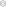

<h1 align="center">
  <picture>
    <source media="(prefers-color-scheme: dark)" srcset="./media/logo_light.svg">
    <source media="(prefers-color-scheme: light)" srcset="./media/logo_dark.svg">
    <!-- The fallback image for older browsers -->
    
  </picture>
   
</h1>

# Geometry Nodes JSON Exporter

A Blender extension designed to automatically extract and apply input values from all internal nodes of specified Geometry Node groups via a structured JSON file.

## Features
- **Dynamic Node Traversal:** Automatically iterates over all internal nodes within targeted Geometry Node groups.
- **Data Serialization:** Casts and extracts exposed values (including basic types, Vectors, and Colors) directly into JSON format.
- **Node Settings:** Settings that aren't sockets (e.g. the Math node's operation or the Compare node's data type) are exported and imported too.
- **Modifier Inputs:** The inputs of every Geometry Nodes modifier that uses a tracked node group are exported and imported, including inputs set to read an attribute.
- **Bi-directional Integration:** Supports both exporting current node values to JSON and importing/applying values from JSON back to the nodes.
- **Auto-Export on Save:** When **Tracking Enabled** is on (the default), the tracking JSON is rewritten on every save of the Blender file. The path is configurable and defaults to `//tracking.json` (next to the `.blend`).
- **Multiple Group Configuration:** Supports queuing multiple Node Groups for batched extraction in a single pass.
- **Recursive Extraction:** Specify a recursion depth to automatically drill down into nested Node Groups and extract their internal node configurations while preserving hierarchy.
- **Filter Standard Nodes:** Optionally extract inputs strictly from node groups, ignoring basic utility or math nodes.
- **Mesh Tracking:** Tracked collections have every mesh object hashed (world transform, vertex positions, edges, faces), so geometry changes show up as a one-line diff.
- **Link Tracking:** The links of every node group in the file are exported, so rewiring shows up in the diff. Sockets with duplicate names (e.g. the three Math `Value` inputs) are told apart as `Value[0]`, `Value[1]`, `Value[2]`.
- **Git Diff Panel:** When the tracking file lives in a git repository, the collapsible **Structural Changes (Uncommitted)** panel lists inputs, node settings, modifier inputs, meshes and links that changed since `HEAD`.
- **Modern Architecture:** Built for Blender 5.2+ using the `blender_manifest.toml` extension system.

## Usage
1. Open the **GeoJSON** tab in the 3D Viewport side-panel (N-panel). It has two collapsible panels: **Structural Changes (Uncommitted)** (the diff) and **Configuration** (targets, tracking settings, Export/Import).
2. Click the `+` button to add a Node Group target.
3. Select your desired Geometry Node tree in the `Node Group` property field (only Geometry Nodes trees are offered).
4. Under **Tracking Enabled**, keep the default tracking file (`//tracking.json`, relative to the `.blend`) or change it. Untick **Tracking Enabled** to stop automatic export on save and the git diff display.
5. In the same row as your added Node Group, set its **Depth** (0 for top-level only, 1 for nested groups inside, etc.).
6. In that same row, toggle the **Groups Only** icon button if you want to skip standard nodes and only export group node inputs for that specific target.
7. Optionally add collections under **Tracked Collections** to track their mesh objects.
8. Click **Export** to save the tracking file manually, or **Import** to apply the stored values. Import reports how many inputs were applied, unchanged, skipped (datablock missing in this file) or failed.

## Notes
- Tracked groups and collections are listed per scene, but the tracking file combines the targets of all scenes. Saving from any scene writes the complete file, and Import applies values to the tracked groups of all scenes. The panel shows a note when other scenes have targets.
- **Tracking Enabled** and the tracking file path are also stored per scene; the active scene's values decide whether and where the file is written.
- If an automatic export fails, the error is shown in the panel and printed to the system console.
- Float values are rounded to 4 decimals, so smaller edits are neither exported nor detected in the diff.
- Hidden (Ctrl+H) inputs are tracked as well, since their values still affect the result.
- Nodes are identified by name and label (`Name (Label)`). Relabelling a node shows up in the diff as its values being removed and re-added, and an older tracking file no longer matches it on import.
- Object, collection, material, image and texture inputs are stored by name. Linked datablocks get the library file name appended, e.g. `Rock (assets.blend)`.
- The tracking file carries a `version`. Files from older versions of the add-on can't be imported, and an older committed file is not diffed; commit a fresh export to continue.
- Mesh hashes cover the stored mesh data and world transform, not the evaluated result of modifiers.
